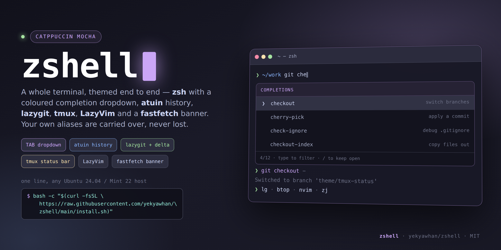

# zshell

`MIT licensed` · a drop-in **Catppuccin Mocha** shell + desktop setup for Ubuntu 24.04 / Linux Mint 22 (Cinnamon):
zsh with a coloured completion dropdown, fuzzy history, a modern CLI stack, git/lazygit, tmux with
session restore, Neovim (LazyVim), a fastfetch shell banner and a fully themed desktop.



```bash
bash -c "$(curl -fsSL https://raw.githubusercontent.com/yekyawhan/zshell/main/install.sh)"
```

---

## Install

**One-liner** (any Ubuntu 24.04 / Mint 22 host):

```bash
bash -c "$(curl -fsSL https://raw.githubusercontent.com/yekyawhan/zshell/main/install.sh)"
```

**Clone first** (recommended — you can read it before it runs):

```bash
git clone https://github.com/yekyawhan/zshell.git ~/.dotfiles && bash ~/.dotfiles/install.sh
```

**Unattended** (no sudo prompt):

```bash
SUDO_PASSWORD='…' bash -c "$(curl -fsSL https://raw.githubusercontent.com/yekyawhan/zshell/main/install.sh)"
```

| Flag | Effect |
|---|---|
| `--dry-run` | print every command, change nothing |
| `--minimal` | shell + CLI tools only (no desktop, no Neovim) |
| `--no-desktop` | skip terminal profile / GTK / Cinnamon theming |
| `--no-nvim` | skip the Neovim config and plugin sync |
| `--no-tmux` | skip TPM plugin installation |
| `--keep-zshrc` | keep your existing `~/.zshrc`, just append the `local.zsh` source line |

> ⚠️ **Your own aliases are safe.** If you already have a `~/.zshrc`, it is copied to
> `~/.zshrc.pre-zshell-<timestamp>` and every alias / export / one-line function in it — plus anything
> in `~/.bashrc` and `~/.bash_aliases` — is carried over into `~/.config/y3kh/local.zsh`, which
> `.zshrc` sources **last**, so your aliases keep working immediately and survive future reinstalls.
> Pass `--keep-zshrc` to leave your existing `~/.zshrc` completely untouched (only the `local.zsh`
> source line is appended). Installer output tells you exactly how many lines it carried over, and any
> line that looks like it holds a secret is skipped and reported instead of being copied.

| Flag | Effect |
|---|---|
| `--dry-run` | print every command, change nothing |
| `--minimal` | shell + CLI tools only (no desktop, no Neovim) |
| `--no-desktop` | skip terminal profile / GTK / Cinnamon theming |
| `--no-nvim` | skip the Neovim config and plugin sync |
| `--no-tmux` | skip TPM plugin installation |
| `--keep-zshrc` | keep your existing `~/.zshrc`, just append the `local.zsh` source line |

The installer is idempotent: re-running skips whatever is already present and only refreshes the
config files. `--dry-run` runs cleanly from a fresh container, so you can read the exact command set
before touching anything.

## What you get

| Area | Contents |
|---|---|
| **Your aliases** | your existing `~/.zshrc` / `~/.bashrc` / `~/.bash_aliases` aliases, exports and one-line functions are **imported into `~/.config/y3kh/local.zsh`** during install — nothing is lost, and the old files are backed up |
| **Shell** | zsh + oh-my-zsh · `zsh-autosuggestions` · `zsh-syntax-highlighting` · **fzf-tab** (TAB opens a coloured dropdown) · a native *list-while-typing* completion wrapper (candidates appear after 2+ characters) |
| **Prompt** | oh-my-posh with 12 themes (default `atomic`) · powerlevel10k config included · Nerd Font glyphs |
| **History** | **atuin** — SQLite history, fuzzy `Ctrl+R`, per-command duration/directory, Catppuccin theme |
| **CLI** | `eza` (ls with icons + git status) · `bat` (cat, Catppuccin theme) · `fzf` · `zoxide` · `fd` · `ripgrep` · `delta` (git pager) · `duf` · `ncdu` · `btop` · `tree` · `jq` |
| **Git** | **lazygit** themed via `gui.darkTheme` · delta side-by-side diffs · fzf branch switcher (`fgb`) · fzf log browser (`fgl`) |
| **Multiplexers** | **tmux** with Catppuccin status bar, `C-a` prefix, TPM + resurrect + continuum (sessions survive reboot) · **zellij** as an alternative |
| **Editor** | **Neovim + LazyVim** with Catppuccin Mocha, LSP, preinstalled tree-sitter parsers, pinned plugin set (`lazy-lock.json`) |
| **Banner** | **fastfetch** on shell start: OS/kernel/desktop/shell, CPU/GPU/RAM/disk, colour palette. Optional LAN IP / Tailscale / active-VPN modules are configured in `config/fastfetch/config.jsonc` |
| **Desktop** | gnome-terminal profile (Catppuccin palette, transparency, Nerd Font, 1.1 cell height) · GTK theme · recoloured Cinnamon shell theme · Papirus icons · Bibata cursor · generated wallpaper |
| **Fonts** | Nerd Font install + a fontconfig rule that renders Burmese/Myanmar with a Unicode font instead of Zawgyi |

### Prompt themes (oh-my-posh)

All 12 are shipped in `oh-my-posh/themes/` and installed to `~/.ohmyposhthemes/`:

`atomic` (default) · `tokyo` · `jandedobbeleer` · `catppuccin_mocha` · `catppuccin_macchiato` ·
`clean-detailed` · `night-owl` · `powerlevel10k_rainbow` · `robbyrussell` · `agnoster` · `star` · `gruvbox`

```bash
theme-list            # what is available
theme tokyo           # switch this shell
theme-atomic | theme-tokyo | theme-jandedobbeleer   # quick presets
```

### Key bindings

| Key | Action |
|---|---|
| `Tab` | coloured fzf dropdown of completions (type to filter, `/` keeps it open) |
| *typing* | candidate list appears by itself after 2+ characters |
| `Ctrl+R` | atuin fuzzy history (`Ctrl+Y` copies the command) |
| `Ctrl+T` | fzf file finder with `bat` preview · `Alt+C` fuzzy cd with `eza` tree preview |
| `Ctrl+G` | ssh host launcher (reads `~/.config/y3kh/ssh-hosts.txt`) |
| `↑` / `↓` | prefix / substring history search |
| `lg` · `nvim` · `zj` · `btop` · `duf` · `eza` · `batcat` | TUIs and modern tools |
| `vpn-status` | tailnet + VPN + LAN IP + routes |
| `nobanner` / `yesbanner` | suppress / restore the fastfetch banner |

## Personal overrides — works for any username

The tracked config is machine-agnostic (**no hardcoded `/home/<user>` paths**) and your personal bits
stay out of git. `~/.zshrc` ends with:

```zsh
[[ -r "$HOME/.config/y3kh/local.zsh" ]] && source "$HOME/.config/y3kh/local.zsh"
```

so `~/.config/y3kh/local.zsh` — created from `config/y3kh/local.zsh.example` on first install — always
wins. Put your ssh shortcuts, VPN helpers, wake-on-lan MACs, work paths and project aliases there.

The same applies to the `Ctrl+G` host list: `config/y3kh/ssh-hosts.example.txt` is installed as
`~/.config/y3kh/ssh-hosts.txt`; edit it, or point `Y3K_HOSTS` at your own file.

## Layout

```
install.sh      the installer
zsh/            .zshrc · .p10k.zsh · oh-my-zsh custom files (dropdown, tools, host launcher)
oh-my-posh/     12 prompt themes (.omp.json)
tmux/           .tmux.conf (Catppuccin status bar; TPM: resurrect + continuum)
nvim/           LazyVim config + lazy-lock.json
config/         fastfetch · atuin (+theme) · lazygit (+theme) · zellij · bat themes · fontconfig
                · y3kh/local.zsh.example · y3kh/ssh-hosts.example.txt
desktop/        style_terminal.sh (terminal profile) · desktop_catppuccin.sh (GTK/Cinnamon/icons/wallpaper)
                · cinnamon-theme/ (recoloured Cinnamon shell theme)
docs/demo.png   the screenshot at the top
```

## Requirements

- Ubuntu 24.04 / Linux Mint 22.x with `apt`, `sudo` and internet access
- Cinnamon for the desktop section (the shell/terminal/CLI parts work on any GTK distro — use `--no-desktop`)
- ~2 GB free for Neovim plugins unless you pass `--no-nvim`
- Outbound access to the GitHub API for the binaries that are not packaged (`fastfetch`, `lazygit`,
  `atuin`, `zellij`, `neovim`, `tree-sitter-cli`)

## Customising

- aliases + fzf/atuin wiring → `zsh/oh-my-zsh-custom/y3kh-tools.zsh`
- completion/dropdown behaviour → `zsh/oh-my-zsh-custom/y3kh-dropdown.zsh`
- lazygit colours → `config/lazygit/config.yml` (colours live under `gui.darkTheme`; `gui.theme` alone is
  ignored by lazygit ≥ 0.66)
- desktop palette → `desktop/desktop_catppuccin.sh`
- terminal profile → `desktop/style_terminal.sh`

After changing anything: `~/.dotfiles/install.sh --dry-run`, then re-run it without the flag.

## Privacy / credentials

This repo was scanned before publishing — every object in its history, not just the tip — for private
and tailnet IPs, MAC addresses, internal hostnames, private domains, credential shapes, personal paths
and email addresses. The only matches are deliberate placeholders (`10.0.0.5`, `aa:bb:cc:dd:ee:ff`
in `local.zsh.example`) and help text that mentions `$SUDO_PASSWORD`.

Nothing here is a credential and nothing points at a private network. The host list is an **example**
file you replace locally, and the sudo password is only ever read from `$SUDO_PASSWORD` (or an
interactive prompt). If you fork this, keep your own machine-specific values in
`~/.config/y3kh/local.zsh`, never in the tracked files.

## Credits

Built on the work of [oh-my-zsh](https://github.com/ohmyzsh/ohmyzsh),
[oh-my-posh](https://ohmyposh.dev), [zsh-autosuggestions](https://github.com/zsh-users/zsh-autosuggestions),
[zsh-syntax-highlighting](https://github.com/zsh-users/zsh-syntax-highlighting),
[fzf](https://github.com/junegunn/fzf) & [fzf-tab](https://github.com/Aloxaf/fzf-tab),
[atuin](https://atuin.sh), [eza](https://github.com/eza-community/eza), [bat](https://github.com/sharkdp/bat),
[zoxide](https://github.com/ajeetdsouza/zoxide), [delta](https://github.com/dandavison/delta),
[lazygit](https://github.com/jesseduffield/lazygit), [tmux](https://github.com/tmux/tmux),
[LazyVim](https://github.com/LazyVim/LazyVim), [fastfetch](https://github.com/fastfetch-cli/fastfetch),
and [Catppuccin](https://catppuccin.com) for the palette.

## License

MIT — see [LICENSE](LICENSE). Do whatever you like with it.
